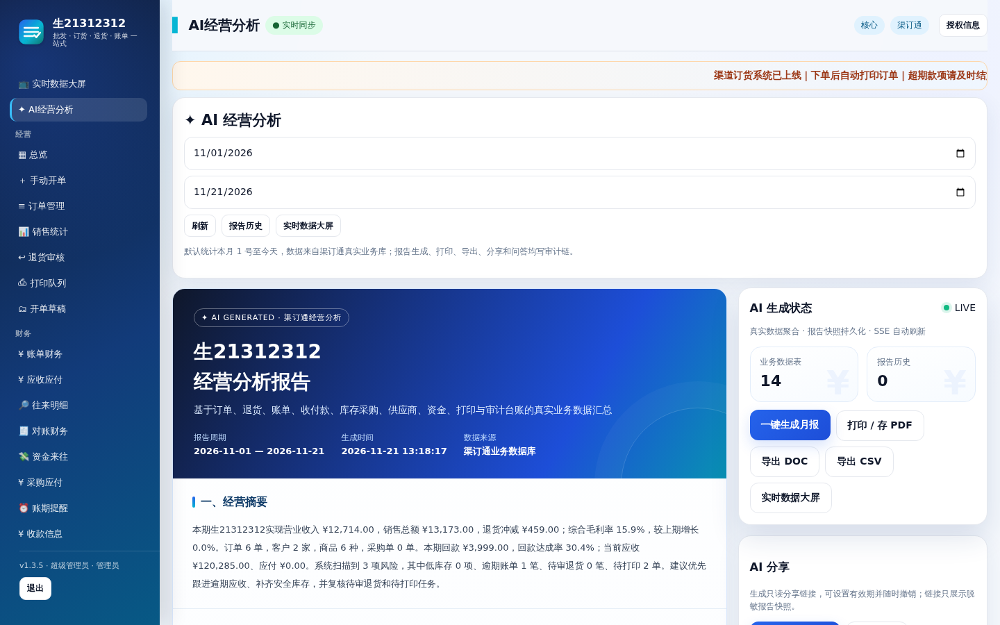
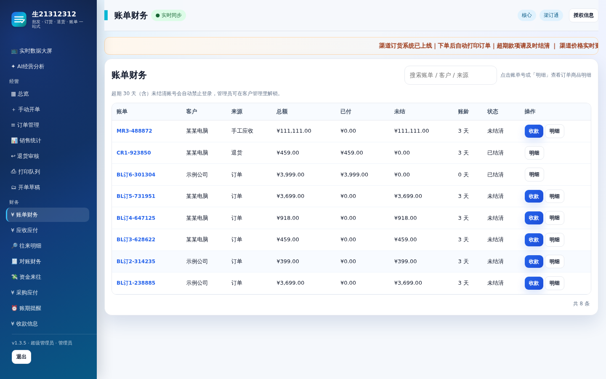
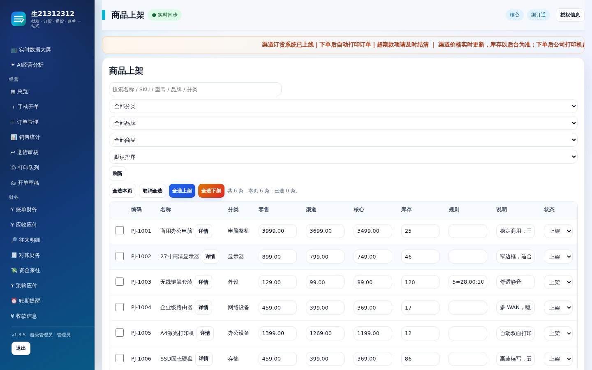

# 渠订通


**批发订货 · 渠道报价 · 进销存 · 账单财务 · 实时数据大屏 · AI 经营分析 · 打印出单 一站式**


渠订通是一套面向**批发商、渠道商、门店和售后网点**的自托管业务系统。它把客户报价、购物车下单、后台开单、库存采购、退货审核、账单财务、往来明细、打印出单、实时经营大屏、AI 经营分析和数据安全放进同一套系统里，用私有部署和统一永久授权替代分散的 Excel、微信群和手工对账。

> **客户看价下单 → 后台开单打印 → 库存 / 采购联动 → 账单应收应付 → 往来明细对账 → 实时大屏与 AI 经营分析 → 权限审计**

---

## v1.3.5 新增亮点

### 1. 实时数据大屏：登录后默认第一屏

- 登录后默认进入「📺 实时数据大屏」，菜单位于「总览」与「AI 经营分析」之前；
- 全页深色大屏，四角圆弧，铺满内容区，不再出现白底、黑边和下拉白框；
- 顶部展示年度营收、本月销售额、累计营收、今日开单、今日收入 / 支出、风险 / 可用率；
- 中间展示客户分布、全年营收 / 回款趋势、实时告警与业务动态；
- 底部展示回款达成、库存健康、经营健康、打印响应，以及全链路实时动态；
- 实时动态来自真实业务库：开单、退货、商品库存、收入、支出、打印、库存流水和审计事件；
- 采用全量历史 + 当日实时双口径，按 SSE / revision 自动刷新，不使用演示数据。


### 2. AI 经营分析：真实业务数据生成报告

- 默认统计**本月 1 号至当前日期**，可手动切换日期范围；
- 聚合订单、退货、账单、收付款、库存采购、供应商、资金、打印和审计等真实业务表；
- 一键生成经营报告快照，支持报告历史、重新打开历史快照、DOC / CSV 导出、打印日志；
- AI 智能助手支持下拉选择诊断问题：经营汇总、回款风险、库存补货、采购应付、退货与打印风险；
- 报告公司名跟随系统设置中的站点名称，改名后侧栏、页面标题、AI 报告封面同步生效；
- 支持创建只读分享链接：token 哈希、有效期、撤销、访问次数和访问审计。



### 3. 账单财务：点击账单号即可查看明细

- 账单列表支持点击账单号或「明细」按钮查看完整详情；
- 订单账单显示关联订单信息和商品明细表；
- 退货账单显示关联退货单信息和退货商品明细；
- 手工应收 / 资金往来账单显示账单说明和收款 / 冲抵记录；
- 详情弹窗包含总额、已付、未结、状态、到期日、创建时间、商品明细和收款记录；
- 收款按钮仍保留，收款后自动刷新账单余额与状态。



### 4. 前台报价下单，后台实时经营

- 客户按**零售 / 渠道 / 核心**等级看到不同价格；商品详情、库存、阶梯价、买赠规则实时同步；
- 前台支持搜索、分类 / 品牌筛选、加入购物车、立即下单、我的订单、我的账单、退换货与收款信息；
- 后台支持手动开单、草稿、金额手动修改、打印队列、订单明细、销售统计与待出单状态。



### 5. 进销存、财务和往来明细一页打通

- 商品库存、分类品牌、价格规则、序列号、盘点、报损报溢、借出返回、采购入库、供应商应付；
- 账单财务、应收应付、对账财务、收支流水、资金来往、账期提醒；
- 「往来明细」按客户 / 公司 / 零售客户 / 供应商 / 日期 / 单号 / 类型汇总订单、退货、账单和收付款，适合月底对账；
- 订单管理和打印队列支持明细查看、状态更新与打印出单。


### 6. 打印出单、权限安全与稳定性

- 连续纸送货单、叠加预印刷表格、完整表格线、打印代理、Windows 打印助手；
- 员工权限按权限点配置，客户首次登录强制改密，账期超期可自动锁定；
- Node.js 24 + `node:sqlite` + 原生 SPA，零 npm 运行时依赖；WAL / FULL / 事务重试 / cluster 多进程；
- 独立安全库、CSRF、会话撤销、登录限流、接口限流、审计哈希链、加密备份、严格 CSP；
- 前端路由增加动态解析与延迟重试，避免多版本脚本加载时序导致「页面函数未定义」；
- 系统设置统一保存并回读校验，站点名称、副标题、页面标题和 AI 报告实时同步。

---

## 界面预览

### 经营总览


### 商品库存与等级价格


### 订单管理与打印队列


### 账单财务明细


### AI 经营分析


### 实时数据大屏


> 以上预览均为 v1.3.5 实际界面；旧版截图仍保留在仓库中作为历史参考。

---

## 功能矩阵

| 模块 | 能力 |
| --- | --- |
| 实时经营 | 登录后默认大屏、实时开单 / 退货 / 商品 / 收支 / 打印 / 审计动态、全年趋势、风险进度 |
| AI 经营分析 | 真实业务数据聚合、默认本月区间、报告快照、历史、DOC / CSV 导出、打印、只读分享、AI 问答 |
| 前台客户 | 商品报价、分类品牌、购物车、订单、账单、退换货、收款信息、账号资料 |
| 后台经营 | 总览、手动开单、订单管理、销售统计、商品库存、价格规则、打印队列 |
| 账单财务 | 账单号 / 明细按钮、订单与退货商品明细、收款记录、收款核销、账期提醒 |
| 采购库存 | 供应商、采购入库、库存台账、盘点、报损报溢、借出返回、序列号 |
| 财务对账 | 应收应付、供应商应付、资金来往、往来明细、收支流水 |
| 系统安全 | 员工权限、通知弹窗、安全中心、加密备份、审计链、动态路由守卫、统一永久授权 |

---

## 快速部署

```bash
mkdir -p /opt/qudingtong/data/security /opt/qudingtong/backups
cd /opt/qudingtong
curl -O https://raw.githubusercontent.com/xiaolurenya/qudingtong/main/docker-compose.yml
curl -O https://raw.githubusercontent.com/xiaolurenya/qudingtong/main/.env.example
cp .env.example .env
# 修改 .env 中的 BOOTSTRAP_ADMIN_PASSWORD
docker compose up -d
```

访问 `http://服务器IP:8282`。首次启动后请立即修改默认管理员密码；生产环境建议启用 HTTPS 与 `QDT_SECURE_COOKIE=1`。升级后浏览器执行 `Ctrl+F5` 强制刷新。

## 镜像与版本

```text
xiaoluya/qudingtong:1.3.5
xiaoluya/qudingtong:latest
digest 以公开仓 version.json 为准
```

## 初始账号

系统首次启动会按 `.env` 中的 `BOOTSTRAP_ADMIN_PASSWORD` 创建管理员，并生成内置员工 / 演示账号。公开文档不提供固定口令；生产环境请在首次登录后修改所有初始凭据。

## 数据与备份

- 主数据库：`./data/qudingtong.db`
- 独立安全库：`./data/security/qudingtong-security.db`
- 加密备份：`./backups`
- 请勿执行 `docker compose down -v`
- 备份恢复不会迁移授权码、设备指纹或会话，换机后需重新激活

## 授权

采用统一永久授权：后台「安全中心 / 授权信息」复制机器码并联系作者获取激活码。激活码使用 Ed25519 签名校验；官方公钥与授权服务地址内置，不接受环境变量或设置表覆盖；备份不包含授权码、设备指纹、会话和密钥材料。

## 文档与仓库

- [部署说明](docs/部署说明.md) · [宝塔部署](docs/宝塔部署.md)
- 公开安装仓：<https://github.com/xiaolurenya/qudingtong>
- Docker Hub：<https://hub.docker.com/r/xiaoluya/qudingtong>

---

文档版本：1.3.5 · 重写实时数据大屏、AI 经营分析、账单财务明细、系统设置同步与动态路由稳定性说明。
