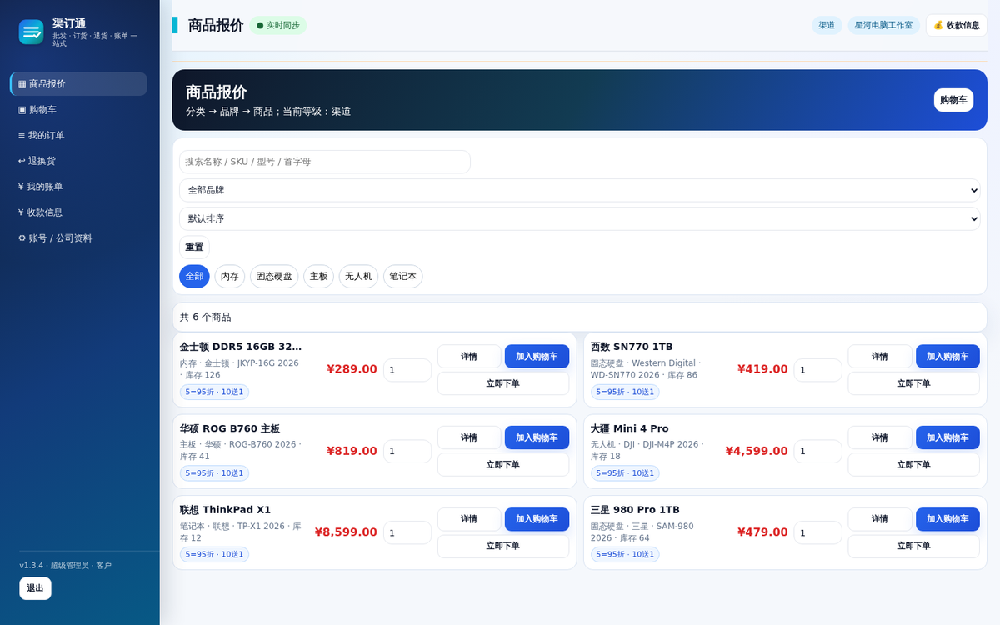
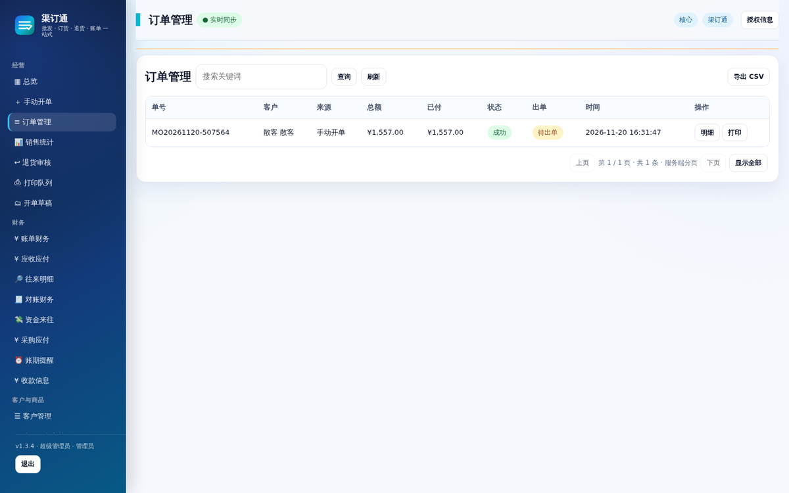
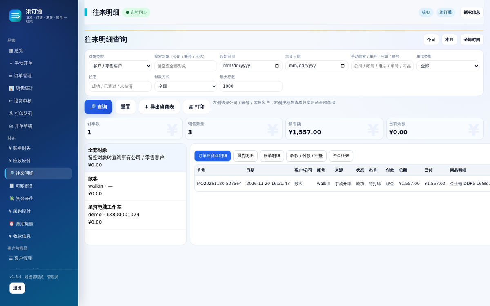

# 渠订通


**批发订货 · 渠道报价 · 进销存 · 账单财务 · 打印出单 一站式**


渠订通是一套面向**批发商、渠道商、门店和售后网点**的自托管业务系统。它把客户报价、购物车下单、后台开单、库存采购、退货审核、账单财务、往来明细、打印出单和数据安全放在同一套系统里，用私有部署和统一永久授权替代分散的 Excel、微信群和手工对账。

> **客户看价下单 → 后台开单打印 → 库存/采购联动 → 账单应收应付 → 往来明细对账 → 账期提醒/权限审计**

---

## 核心亮点

### 1. 前台报价下单，后台实时经营

- 客户按**零售 / 渠道 / 核心**等级看到不同价格；商品详情、库存、阶梯价、买赠规则实时同步；
- 前台支持搜索、分类/品牌筛选、加入购物车、立即下单、我的订单、我的账单、退换货与收款信息；
- 后台支持手动开单、草稿、金额手动修改、打印队列、订单明细、销售统计与待出单状态。



### 2. 进销存、财务和往来明细一页打通

- 商品库存、分类品牌、价格规则、序列号、盘点、报损报溢、借出返回、采购入库、供应商应付；
- 账单财务、应收应付、对账财务、收支流水、资金来往、账期提醒；
- 「往来明细」按客户 / 公司 / 零售客户 / 供应商 / 日期 / 单号 / 类型汇总订单、退货、账单和收付款，适合月底对账。


### 3. 打印出单与权限安全

- 连续纸送货单、叠加预印刷表格、完整表格线、打印代理、Windows 打印助手；
- 员工权限按权限点配置，客户首次登录强制改密，账期超期可自动锁定；
- Node.js 24 + `node:sqlite` + 原生 SPA，零 npm 运行时依赖；WAL / FULL / 事务重试 / cluster 多进程；
- 独立安全库、CSRF、会话撤销、登录限流、接口限流、审计哈希链、加密备份、严格 CSP。

---

## 界面预览

### 商品库存与等级价格


### 订单管理与打印队列



### 往来明细查询



---

## 功能矩阵

| 模块 | 能力 |

| --- | --- |
| 前台客户 | 商品报价、分类品牌、购物车、订单、账单、退换货、收款信息、账号资料 |
| 后台经营 | 总览、手动开单、订单管理、销售统计、商品库存、价格规则、打印队列 |
| 采购库存 | 供应商、采购入库、库存台账、盘点、报损报溢、借出返回、序列号 |
| 财务对账 | 应收应付、供应商应付、账单财务、资金来往、往来明细、账期提醒 |
| 系统安全 | 员工权限、通知弹窗、安全中心、加密备份、审计链、统一永久授权 |

---
## 快速部署

```bash
mkdir -p /opt/qudingtong/data/security /opt/qudingtong/backups
cd /opt/qudingtong
curl -O https://raw.githubusercontent.com/xiaolurenya/qudingtong/main/docker-compose.yml
curl -O https://raw.githubusercontent.com/xiaolurenya/qudingtong/main/.env.example
cp .env.example .env
# 修改 .env 中的 BOOTSTRAP_ADMIN_PASSWORD
docker compose up -d
```

访问 `http://服务器IP:8282`。首次启动后请立即修改默认管理员密码；生产环境建议启用 HTTPS 与 `QDT_SECURE_COOKIE=1`。

## 镜像与版本

```text
xiaoluya/qudingtong:1.3.4
xiaoluya/qudingtong:latest
sha256:b95f7023b8b0c001d198a213620598315269945d1e39c4c7535c9a6356f0b600
```

## 初始账号

系统首次启动会按 `.env` 中的 `BOOTSTRAP_ADMIN_PASSWORD` 创建管理员，并生成内置员工/演示账号。公开文档不提供固定口令；生产环境请在首次登录后修改所有初始凭据。

## 数据与备份

- 主数据库：`./data/qudingtong.db`
- 独立安全库：`./data/security/qudingtong-security.db`
- 加密备份：`./backups`
- 请勿执行 `docker compose down -v`
- 备份恢复不会迁移授权码、设备指纹或会话，换机后需重新激活

## 授权

采用统一永久授权：后台「安全中心 / 授权信息」复制机器码并联系作者获取激活码。激活码使用 Ed25519 签名校验；官方公钥与授权服务地址内置，不接受环境变量或设置表覆盖；备份不包含授权码、设备指纹、会话和密钥材料。

## 文档与仓库

- [部署说明](docs/部署说明.md) · [宝塔部署](docs/宝塔部署.md)
- 公开安装仓：<https://github.com/xiaolurenya/qudingtong>
- Docker Hub：<https://hub.docker.com/r/xiaoluya/qudingtong>

---

文档版本：1.3.4 · 项目介绍优化版。
