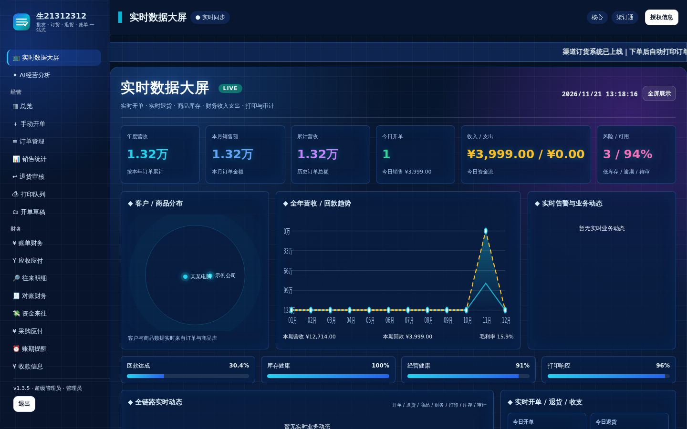
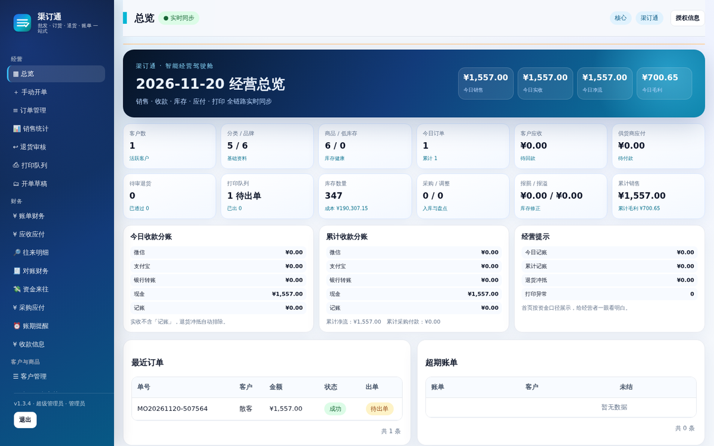

# 渠订通 · QudingTong

> **批发订货 · 渠道报价 · 进销存 · 账单财务 · 实时数据大屏 · AI 经营分析 · 打印出单 一站式**

   

渠订通是一套面向**批发商、渠道商、门店和售后网点**的自托管业务系统。它把客户报价、购物车下单、后台开单、库存采购、退货审核、账单财务、往来明细、打印出单、实时经营大屏、AI 经营分析和数据安全放进同一套系统里，用私有部署和统一永久授权替代分散的 Excel、微信群和手工对账。

> **客户看价下单 → 后台开单打印 → 库存 / 采购联动 → 账单应收应付 → 往来明细对账 → 实时大屏与 AI 经营分析 → 权限审计**

---

## 界面预览

| 实时数据大屏 | AI 经营分析 |
| --- | --- |
|  |  |

| 经营总览 | 账单财务明细 |
| --- | --- |
|  |  |

| 商品库存与等级价格 | 订单管理与打印队列 |
| --- | --- |
|  |  |

---

## 核心功能

| 模块 | 能力 |
| --- | --- |
| 实时经营 | 登录后默认大屏，实时开单 / 退货 / 商品 / 收支 / 打印 / 审计动态、全年趋势、风险进度 |
| AI 经营分析 | 真实业务数据聚合、默认本月区间、报告快照、历史、DOC / CSV 导出、打印、只读分享、AI 问答 |
| 前台客户 | 商品报价、分类品牌、购物车、订单、账单、退换货、收款信息、账号资料 |
| 后台经营 | 总览、手动开单、订单管理、销售统计、商品库存、价格规则、打印队列 |
| 账单财务 | 账单号 / 明细按钮、订单与退货商品明细、收款记录、收款核销、账期提醒 |
| 采购库存 | 供应商、采购入库、库存台账、盘点、报损报溢、借出返回、序列号 |
| 财务对账 | 应收应付、供应商应付、资金来往、往来明细、收支流水 |
| 系统安全 | 员工权限、通知弹窗、安全中心、加密备份、审计链、动态路由守卫、统一永久授权 |

---

## 镜像与版本

- Docker Hub：<https://hub.docker.com/r/xiaoluya/qudingtong>
- 固定版本：`xiaoluya/qudingtong:1.3.7`
- 当前 digest：`sha256:5516d858b14efba6757febd75fa23ce6c78fa979a5774e38598f824c6f7665ba`
- 默认端口：`8282`

---

## Docker Compose 安装

新建 `/opt/qudingtong` 目录，保存以下内容为 `docker-compose.yml`：

```yaml
services:
  qudingtong:
    image: xiaoluya/qudingtong:1.3.7@sha256:5516d858b14efba6757febd75fa23ce6c78fa979a5774e38598f824c6f7665ba
    container_name: qudingtong
    user: "${QDT_UID:-1000}:${QDT_GID:-1000}"
    restart: unless-stopped
    ports:
      - "8282:8282"
    environment:
      PORT: "8282"
      TZ: "Asia/Shanghai"
      NODE_ENV: "production"
      WEB_CONCURRENCY: "4"
      DATA_DIR: "/app/data"
      QDT_DB_DIR: "/app/data"
      QDT_SECURITY_DB_DIR: "/app/data/security"
      QDT_BACKUP_DIR: "/app/backups"
      BOOTSTRAP_ADMIN_USER: "admin"
      BOOTSTRAP_ADMIN_PASSWORD: "${BOOTSTRAP_ADMIN_PASSWORD:?请在 .env 中设置管理员初始密码}"
      SESSION_SECRET: "${SESSION_SECRET:-}"
      QDT_BACKUP_PEPPER: "${QDT_BACKUP_PEPPER:-}"
      QDT_AGENT_TOKEN: "${QDT_AGENT_TOKEN:-}"
      QDT_SECURE_COOKIE: "0"
    volumes:
      - ./data:/app/data
      - ./backups:/app/backups
    healthcheck:
      test: ["CMD", "node", "-e", "fetch('http://127.0.0.1:8282/api/health').then(r=>process.exit(r.ok?0:1)).catch(()=>process.exit(1))"]
      interval: 30s
      timeout: 5s
      retries: 3
      start_period: 10s
```

同目录新建 `.env`：

```ini
BOOTSTRAP_ADMIN_USER=admin
BOOTSTRAP_ADMIN_PASSWORD=请改成强密码
SESSION_SECRET=请改成随机字符串
QDT_BACKUP_PEPPER=请改成随机字符串
QDT_AGENT_TOKEN=请改成随机字符串
QDT_SECURE_COOKIE=0
QDT_UID=1000
QDT_GID=1000
```

初始化并启动：

```bash
mkdir -p /opt/qudingtong/data/security /opt/qudingtong/backups
cd /opt/qudingtong
# 将上面的 docker-compose.yml 与 .env 保存到当前目录
docker compose pull
docker compose up -d
docker compose logs -f --tail=80
```

访问：

```text
http://服务器IP:8282
```

健康检查：

```bash
curl http://127.0.0.1:8282/api/health
```

生产环境建议：

- 使用 Nginx / 宝塔反向代理并启用 HTTPS；
- 启用 HTTPS 后设置 `QDT_SECURE_COOKIE=1`；
- 首次登录立即修改管理员密码；
- 升级后浏览器按 `Ctrl+F5` 强制刷新。

---

## 飞牛 NAS 安装包

- [GitHub Releases / v1.3.7](https://github.com/xiaolurenya/qudingtong/releases/tag/v1.3.7)
- 附件：`QudingTong-1.3.7-Feiniu.fpk`
- 安装向导可设置管理员密码，默认端口 `8282`
- 数据保存在套件 `data / backups` 目录，升级或重装不要删除

---

## 初始账号与数据

- 首次启动会按 `.env` 中的 `BOOTSTRAP_ADMIN_PASSWORD` 创建 `admin`；
- 公开文档不提供固定生产口令；请首次登录后立即修改；
- 主数据库：`./data/qudingtong.db`；
- 独立安全库：`./data/security/qudingtong-security.db`；
- 加密备份：`./backups`；
- **不要执行 `docker compose down -v`**。

---

## 授权

采用统一永久授权：后台「安全中心 / 授权信息」复制机器码并联系作者获取激活码。激活码使用 Ed25519 签名校验；官方公钥与授权服务地址内置，不接受环境变量或设置表覆盖；备份不包含授权码、设备指纹、会话和密钥材料。

---

## 文档与仓库

- [部署说明](docs/部署说明.md) · [宝塔部署](docs/宝塔部署.md)
- 公开安装仓：<https://github.com/xiaolurenya/qudingtong>
- 私有源码仓：`xiaolurenya/qudingtong-src`
- Docker Hub：<https://hub.docker.com/r/xiaoluya/qudingtong>

---

文档版本：1.3.7 · 实时数据大屏、AI 经营分析、账单财务明细、动态路由稳定性与系统设置同步。
